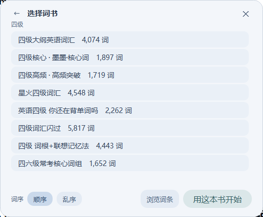
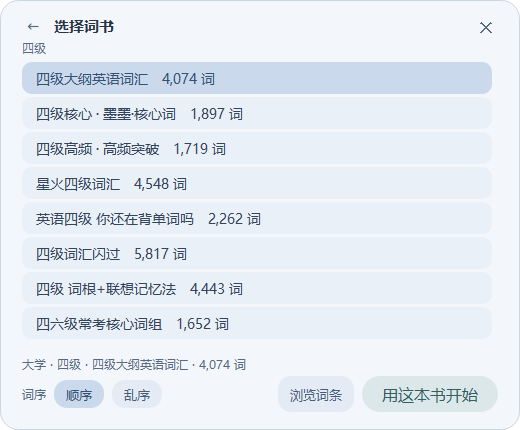
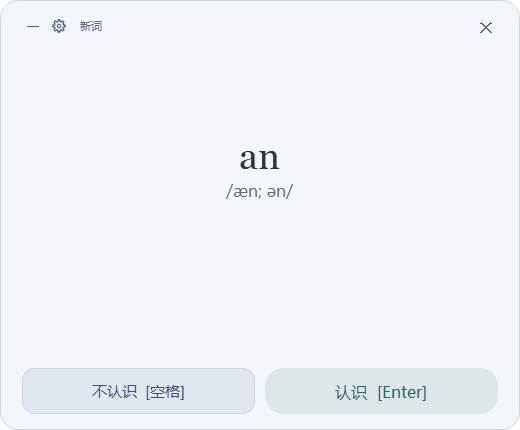
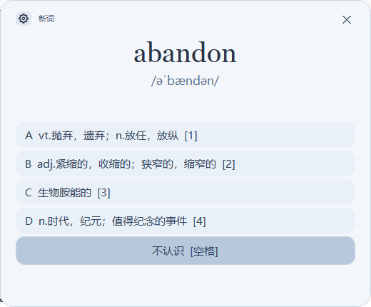
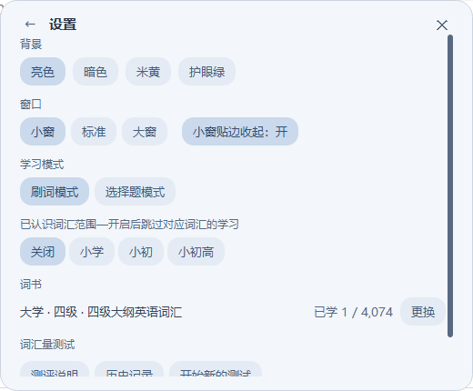

# 背单词 · Windows 桌面版

离线 Windows 背单词应用：词书浏览、记忆排期、四选一练习和词汇量测评都在本机完成。学习记录保存在应用目录的 `userdata/`，不上传网络。

## 功能特色

- **离线使用**：内置词库，不需要联网或 Python 环境（便携版）。
- **多种学习方式**：刷词、四选一释义、词汇量测评。
- **记忆排期**：认识后逐级升级；忘记不降级，约 5 分钟后再次复习。
- **词书管理**：按词书浏览、搜索和选择学习范围，支持顺序或乱序。
- **本地资料安全**：学习进度、窗口位置和备份文件保存在 `userdata/`，采用原子保存并保留上一份有效备份。
- **主题配色**：提供多套主题，窗口可拖动，适合常驻桌面学习。

## Windows 便携版

从 [Releases](https://github.com/zijian-ai-projects/vocab-app/releases) 下载 `VocabApp-*-windows-x64.zip`，解压后双击 `VocabApp.exe`，无需安装 Python 或 Anaconda。

- `VocabApp.exe`：主程序
- `ResetRecords.exe`：交互式清空学习记录工具
- `userdata/`：学习记录，请勿删除
- `_internal/`：程序运行库，请勿删除或移动

首次运行后，学习记录会写入 `userdata/`。换电脑时复制整个应用目录即可迁移记录。Windows 可能对未签名程序显示 SmartScreen 提示，请确认下载来源和校验值后再运行。

## 从源码运行

源码运行需要 Python 3 和兼容的 PyQt5 环境。在项目根目录运行：

```powershell
python -B app/launcher.py
```

构建 Windows 便携包：

```powershell
python -B release/build_windows.py
```

构建脚本只把运行必需的词库和资源放进发布包，不会把 `userdata/`、测试脚本或日志打包进去。

## 数据与隐私

Windows 端与 DSH Web 插件是两个独立客户端，学习记录不自动同步。DSH 插件源码和说明位于独立仓库：[dsh-vocab](https://github.com/zijian-ai-projects/dsh-vocab)。

词汇量测评是基于本地词频和固定模型参数的估计，不等同 CEFR、VST 词族数或考试成绩；详细方法与限制见 [`docs/`](docs/)。

## 截图

以下为 **Windows V1.4.3 实际程序截图**，使用独立演示资料目录，不包含个人学习记录。

### 词书选择





### 刷词卡片



### 四选一练习



### 主题与学习设置



## 许可

本仓库用于个人项目发布。词库及第三方内容的再分发权请以仓库当前声明和具体来源许可为准。
